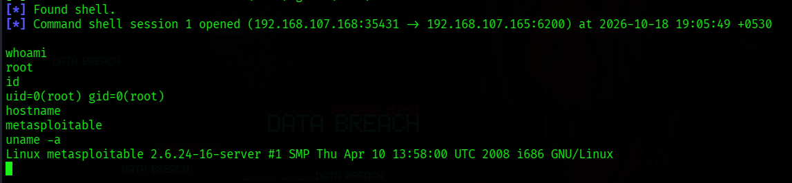
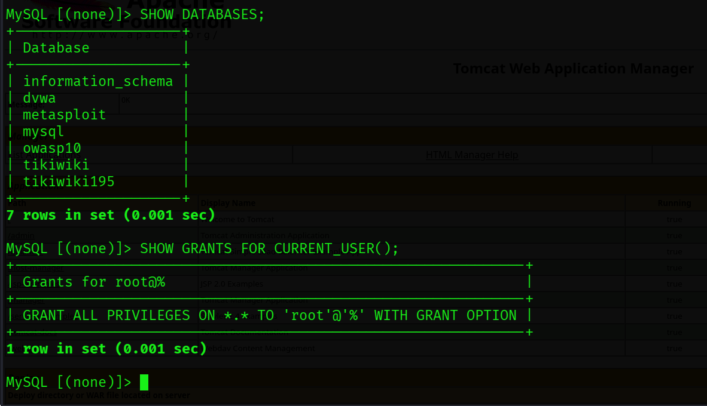
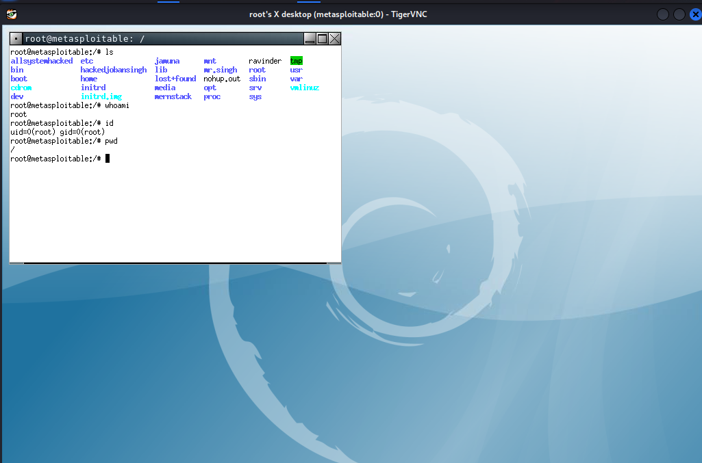

# Metasploitable 2 | Network Service Security Assessment

**Independent hands-on penetration-testing lab**  
**Environment:** Kali Linux + Metasploitable 2, isolated virtual network  
**Assessment date:** 18–19 October 2026  
**Assessor:** CyberSingh

> **Lab only.** Metasploitable 2 is intentionally vulnerable. The results in this repository come from a controlled learning environment, not a client engagement or a production network. No live third-party systems were tested.

## What I worked on

I assessed the network services exposed by a Metasploitable 2 VM, then tested which observations could actually be confirmed from the client side. My aim was to practice the full workflow: **service discovery → validation → proof of impact → screenshots → remediation notes**.

The most useful part of this exercise was separating a *service that appears vulnerable* from a *service where I could demonstrate access*. In the report, a successful root shell is treated differently from an HTTP status code or a version banner.

### Environment & tools

- **Testing VM:** Kali Linux (`192.168.107.168`)
- **Target VM:** Metasploitable 2 (`192.168.107.165`)
- **Setup:** Private, isolated VMware network; lab-only IP addresses
- **Tools used:** Nmap, Metasploit Framework, Netcat, rlogin, MySQL client, PostgreSQL `psql`, TigerVNC, NFS client tools, FTP client, and terminal screenshots

## Results

| Service | Port | Evidence-based outcome |
|---|---:|---|
| vsftpd backdoor | 21 / 6200 | Command shell opened; `id` confirmed root |
| Exposed bind shell | 1524 | Direct shell; `whoami` and `id` confirmed root |
| rlogin | 513 | Passwordless root login demonstrated |
| MySQL | 3306 | Remote database root access and `ALL PRIVILEGES` confirmed |
| PostgreSQL | 5432 | `postgres` login and superuser role verified |
| VNC | 5900 | Remote graphical session running as root |
| NFS | 111 / 2049 | Root filesystem export visible to wildcard clients; read-only access demonstrated |
| ProFTPD | 2121 | Successful authenticated FTP session demonstrated; password strength not established |
| Tomcat Manager | 8180 | Manager endpoint responded; administrative deployment rights not proven by available screenshots |

**Interpretation matters:** A login or a service version is not automatically a confirmed exploit. The detailed report records the strength and limits of each piece of evidence.

## Full report

📄 **[Read the assessment (PDF)](report/Metasploitable2_Network_Service_Assessment.pdf)**

The report contains scope, methodology, nine service-level observations, technical evidence, potential impact, remediation guidance, and limitations. Screenshots are also saved separately in [`evidence/`](evidence/) for convenient review.

## Selected evidence

**vsftpd — demonstrated root shell**  

**MySQL — database-level privileges**  

**VNC — root graphical desktop**  

## Key takeaways

1. Exposed legacy services can create direct routes to privileged access, even without an interactive reverse payload.
2. Screenshots should connect the **test performed**, **response observed**, and **security implication**. These are different things.
3. Network segmentation and removal of unnecessary services are foundational controls; application-level patches alone cannot compensate for an exposed root shell.
4. Claims must stay inside the available evidence. For example, a successful database login does not by itself prove that an empty password was used.

## Scope and ethical use

This repository documents a locally controlled practice environment. No malware, credential harvesting, persistence, or unauthorized third-party testing is part of the published project. **DVWA web-app testing is intentionally a separate assessment.**

If reproducing these tests, keep the target on an **isolated host-only virtual network**. Never expose Metasploitable 2 to the internet or your normal home/office LAN.

## Evidence directory

| Folder | Topic |
|---|---|
| `01_vsftpd` | FTP backdoor and command-shell evidence |
| `02_bind_shell` | Network-exposed privileged shell |
| `03_rlogin` | Legacy remote login |
| `04_mysql` | Remote database administrative privileges |
| `05_postgresql` | Database role verification |
| `06_vnc` | Remote graphical desktop |
| `07_nfs` | Network filesystem exposure |
| `08_proftpd` | FTP service and authenticated access |
| `09_tomcat` | Manager endpoint |

---

*This is a learning portfolio case study. The original commands and results are documented to explain the assessment process; no client authorization or production risk acceptance is implied.*